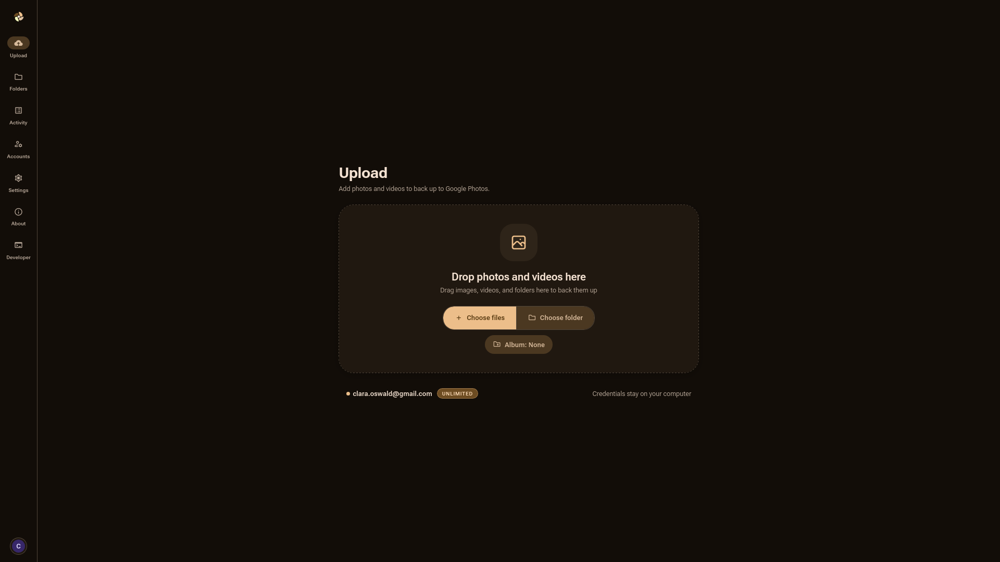

# Lumen

**Unlimited Google Photos backup for your computer in full original quality.**




> [!NOTE]
> *Looking for the Android app? Check out **[Lumen for Android](https://github.com/Reiux/lumen-android)**.*

Lumen is an unofficial desktop client for Google Photos, built with Wails and Vue 3. It's a fork of [gotohp](https://github.com/xob0t/gotohp) with a redesigned Material 3 Expressive interface. Core upload and authentication logic come from upstream.

### How it works
Google gives free original-quality uploads to certain Pixel devices. When you upload through Lumen, it sends your files directly from your computer to Google Photos with headers that tell Google's servers they come from a Pixel. Google stores them at full resolution and your storage space stays untouched. You can also switch to Storage Saver or Use Quota in the app.

Everything runs on your computer. No middleman servers, no paid accounts, no ads, and no tracking.

> **Disclaimer:** Unofficial client. Not affiliated with, endorsed by, or supported by Google LLC. Google Photos is a trademark of Google LLC. Using Lumen may violate Google's Terms of Service. See [Account Safety & Risks](#account-safety--risks).

---

## Features

- **Unlimited original quality:** Upload photos and videos without counting against your Google storage. You can switch to Storage Saver or Use Quota at any time.
- **Automatic sign-in:** Lumen opens a Chromium browser (Chrome, Brave, Edge, etc.), picks up your sign-in and closes it. Manual token entry is available as a fallback.
- **Material 3 Expressive interface:** Color themes, light and dark mode, and a navigation rail that adapts to the window size.
- **Albums:** Upload into an existing album by pasting its key or link, give it a nickname, or create albums named after your folders. Reusing a name reuses the album.
- **Folder watcher:** Watch folders in the background and upload new photos as they are added, with an option to include subfolders.
- **Duplicate skipping:** Hashes of uploaded files are cached locally, so files you already backed up are skipped.
- **Apple Live Photos:** Pairs `.heic` and `.jpg` photos with their matching `.mov` clips.
- **Bandwidth limiter:** Limit uploads from 0.5 MB/s to 50 MB/s, or leave it unlimited.
- **Multiple accounts:** Add and switch between Google accounts.
- **Drag and drop:** Drop files or folders into the window, or use the picker.
- **System tray:** Keeps running in the background and notifies you when an upload finishes.
- **Standalone CLI:** A headless `lumen-cli` binary for scripts, servers and cron jobs.

---

## Security & Account Access

**Your password is never requested, stored, or seen by Lumen.**

When you sign in, Google gives the app an **OAuth token**.
- It works like a temporary key card that lets Lumen put photos into your Google Photos library.
- Uploads go straight from your computer to Google. No outside server touches your data.
- The token is stored in your operating system's secure credential manager (Linux Secret Service, Windows Credential Manager, macOS Keychain), not in a plain file.
- Lumen contains no analytics, telemetry or crash reporting.

---

## Requirements

- Windows, macOS or Linux
- A Google account
- A Chromium-based browser (Chrome, Brave, Edge, Chromium, Vivaldi) for automatic sign-in. Without one, you can paste a token manually.
- An internet connection

---

## Download

Get the latest build for your system on the [Releases](https://github.com/Reiux/Lumen/releases/latest) page:

| System | File |
|---|---|
| Windows | `.exe` |
| macOS | `.dmg` |
| Linux | binary / package for your distro |
| Any (no GUI) | `lumen-cli` |

> Replace the file names above with the exact names used in your releases.

Found a bug or have an idea? [Open an issue](https://github.com/Reiux/Lumen/issues/new/choose).

---

## Sign In

### Option 1: Automatic sign-in (recommended)

1. Open Lumen and click **Connect Account**.
2. Lumen opens your Chromium browser. Sign in to your Google account and accept the prompt.
3. Lumen picks up the sign-in, closes the browser and deletes its temporary profile.

Firefox, Zen and Safari are not supported for automatic sign-in because Google blocks them in this flow. If you don't have a Chromium browser, use Option 2.

### Option 2: Manual token

1. Open Lumen and click **Connect Account**, then choose manual entry.
2. Open the Google sign-in page in any browser and sign in. Click **I agree** on the Google Embedded Setup page. (If the page keeps loading afterward, that's normal.)
3. Open Developer Tools (`F12`), go to **Application** (or **Storage**) -> **Cookies** -> `https://accounts.google.com`.
4. Copy the value of the `oauth_token` cookie.
5. Paste it into Lumen and click **Connect account**.

From the CLI:
```shell
lumen-cli creds add "<oauth_token value>"
```

### Option 3: ReVanced (No root required)

<details>
  <summary><strong>View instructions</strong></summary>

1. Install Google Photos ReVanced on your Android device or emulator:
   - Install [GmsCore](https://github.com/ReVanced/GmsCore/releases).
   - Install a patched Google Photos APK (via [Morphe-AutoBuilds](https://github.com/RookieEnough/Morphe-AutoBuilds/releases) or patch it yourself using ReVanced Manager).
2. Enable USB debugging and connect your device to your PC via ADB.
3. Open a terminal on your PC and run:

   **Linux / macOS:**
   ```shell
   adb logcat | grep "auth%2Fphotos.native"
   ```

   **Windows (Command Prompt):**
   ```cmd
   adb logcat | FINDSTR "auth%2Fphotos.native"
   ```

4. If you already had an account logged in, remove the Google account from GmsCore first.
5. Open Google Photos ReVanced on the device and sign in.
6. A log line containing the authentication parameters will appear in your terminal.
7. Copy the string starting from `androidId=` through to the end of that line.
8. Paste that string into Lumen or run `lumen-cli creds add "androidId=..."`.

</details>

### Option 4: Official APK (Root required)

<details>
  <summary><strong>View instructions</strong></summary>

1. Make sure you have a rooted Android device or emulator with ADB root access.
2. Connect your device via ADB and install [HTTP Toolkit](https://httptoolkit.com).
3. In HTTP Toolkit, choose **Android Device via ADB** intercept mode.
4. Filter intercepted traffic using:
   ```text
   contains(https://www.googleapis.com/auth/photos.native)
   ```
   *(For older Google Photos versions, try `contains(www.googleapis.com%2Fauth%2Fplus.photos.readwrite)`).*
5. Open the official Google Photos app on your device and log in.
6. When the matching request appears in HTTP Toolkit, copy the request body text.
7. Paste the body string into Lumen.
8. If Lumen asks for a token binding key, keep the device connected with ADB root enabled and click **Read from ADB**. Lumen will read `lstBindingKeyAlias` from the Android AccountManager and attach it to the credential.

#### Troubleshooting
- **No request intercepted:** Log out and log back in, or use HTTP Toolkit's `Android App via Frida` interception method.
- **Token binding key not found:** Confirm root is granted to ADB shell (`adb root`) and the target Google account is present on the device.

</details>

---

## CLI Usage

The standalone binary `lumen-cli` runs without any GUI dependencies. The desktop binary `lumen` also accepts these commands.

```shell
# Upload photos recursively using 5 threads
lumen-cli upload /path/to/photos --recursive --threads 5

# Upload to an album (by name, creating it if needed; an album key or link also works)
lumen-cli upload /path/to/trip --album "Tokyo 2026"

# Pair Apple Live Photos
lumen-cli upload /path/to/camera --pair-live-photos

# Use Storage Saver quality instead of original quality
lumen-cli upload /path/to/photos --saver

# Add credentials
lumen-cli creds add "<oauth_token cookie value>"
lumen-cli creds add "androidId=..."
lumen-cli creds add - < token.txt

# List and switch active account
lumen-cli creds list
lumen-cli creds set user@gmail.com
```

The CLI shares stored credentials with the app. Upload options are controlled by command-line flags so scripts run predictably. Run `lumen-cli --help` or `lumen-cli upload --help` for all options.

---

## Building from Source

### Prerequisites

- **Go:** version from `go.mod` (CHECK)
- **Node.js:** version from `frontend/.node-version` (CHECK)
- **C compiler:** `gcc` or `clang`
- **Linux packages:** CHECK against the CI workflow (it installs `libgtk-4-dev` and `libwebkitgtk-6.0-dev`)
- **Wails v3 CLI (optional):**
  ```shell
  go install github.com/wailsapp/wails/v3/cmd/wails3@v3.0.0-beta.33
  ```

### Build steps

```shell
git clone https://github.com/Reiux/Lumen.git
cd Lumen

# Frontend
cd frontend && npm install && npm run build && cd ..

# Desktop app
go build -o bin/lumen .

# Standalone CLI
go build -tags cli -o bin/lumen-cli .
```

Or with [Task](https://taskfile.dev): `task build`

---

## Account Safety & Risks

Lumen is an unofficial tool and isn't affiliated with Google. It uploads photos using an unofficial method that Google didn't design for third-party apps.

- **Terms of Service:** Using Lumen may violate Google's Terms of Service. Google can log you out, limit, or ban your account at any time.
- **Gmail & Drive access:** If Google restricts your account, you could lose access to Gmail, Google Drive, and other services linked to that email.
- **Use a secondary account:** Use an email you're okay with losing access to. Don't use your primary personal email or accounts used for work, school, or banking.
- **Keep your local copies:** Don't rely on Google Photos as your only backup. Keep your original files until the backup is verified.
- **Avoid repeated sign-ins:** If Google logs you out or asks for verification, don't spam sign-in attempts. Lumen pauses automatically when it detects account issues. Each sign-in registers a new device, so avoid logging in and out repeatedly.

---

## Configuration

Lumen stores settings and saved accounts in:
- **Linux:** `~/.config/lumen/lumen.config`
- **macOS:** `~/Library/Application Support/lumen/lumen.config`
- **Windows:** `%APPDATA%\lumen\lumen.config`

To run portably, place an empty `lumen.config` file next to the binary.

---

## Privacy & Network Transparency

- **No analytics or telemetry:** No trackers, crash reporters or usage statistics.
- **Direct to Google:** Uploads, sign-in and media requests go straight between your computer and Google. Lumen runs no servers or relays.
- **Update checks:** Lumen only contacts github.com to look for new releases, and only when automatic update checks are on. You can turn this off in the app under **About -> Updates**.
- **Local credentials:** Tokens stay on your device in the OS credential manager and are only sent to Google.
- **Sign-in browser:** The browser used for automatic sign-in runs with a temporary profile that is deleted when it closes.

---

## Credits & License

- Original project and upload logic: [gotohp](https://github.com/xob0t/gotohp) by [xob0t](https://github.com/xob0t).
- UI redesign and enhancements: [Reiux](https://github.com/Reiux).
- Licensed under the [MIT License](LICENSE).
