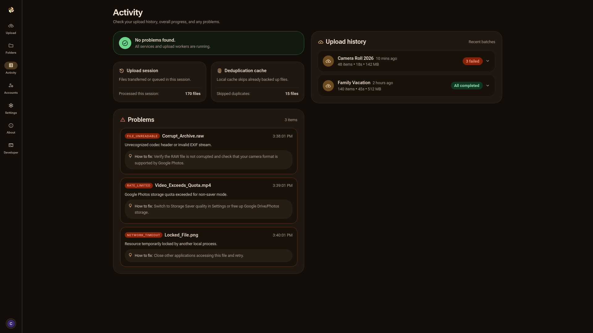
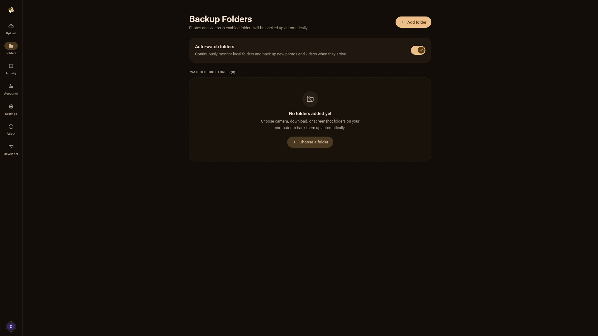
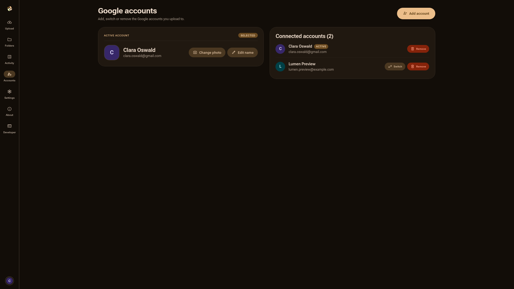
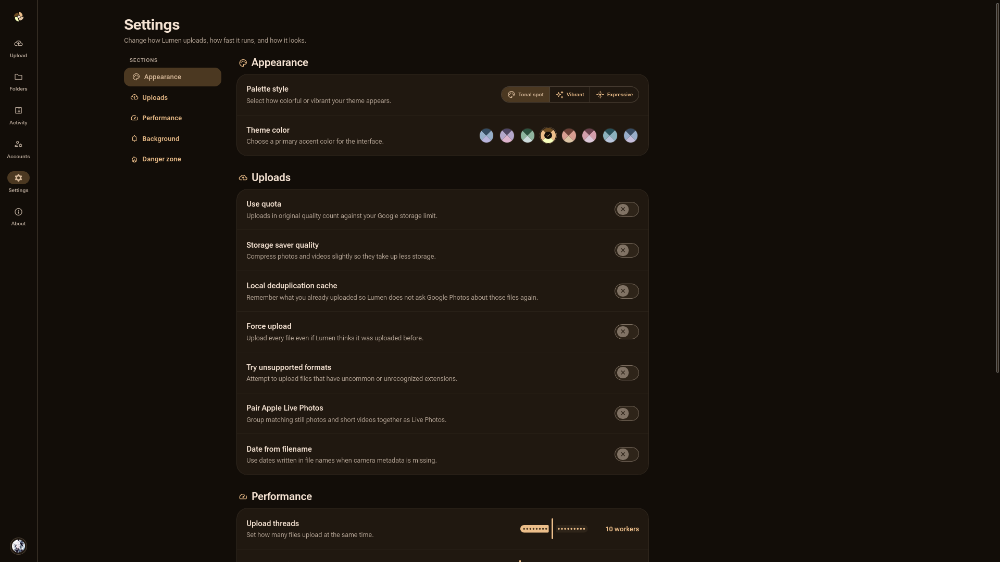
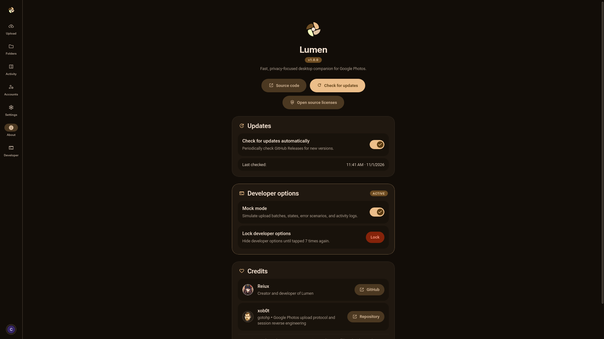

# Lumen

**Fast, open-source desktop backup client for Google Photos.**


> [!NOTE]
> **Disclaimer:** Lumen is an independent open-source project and is not affiliated with, endorsed by, or supported by Google LLC. Google Photos is a trademark of Google LLC.
>
> *Looking for the Android app? Check out **[Lumen for Android](https://github.com/Reiux/lumen-android)**.*  
> *Looking for the archived Go version? Check out the **[legacy-go branch](https://github.com/Reiux/Lumen/tree/legacy-go)**.*

Lumen 2.0 is an unofficial desktop client for Google Photos, rewritten from scratch in **Rust** using **Tauri 2** and **Vue 3**. It replaces the old Go codebase with a much lighter core engine (`lumen-core`), cutting binary sizes in half, dropping idle RAM usage, and bringing native Material 3 theming to Linux, Windows, and macOS.

### How it works

Lumen lets you back up photos and videos straight from your desktop to Google Photos. It talks directly to Google's mobile upload endpoints with device profile headers, so your media can upload in full original quality without eating your storage quota (or you can toggle Storage Saver / Use Quota in the settings if you prefer).

Everything runs locally on your machine. No middleman servers, no extra accounts, no ads, and no tracking.

---

## Features

- **Original quality uploads:** Back up photos and videos at full resolution without counting against your Google storage, or switch to Storage Saver / standard quota mode whenever you want.
- **Native Rust 2.0 architecture:** Stripped GUI binary is under 16 MB (48% smaller than Go) and CLI binary is just 5.3 MB (81% smaller than Go) with up to 41% less RAM usage and zero garbage collection overhead.
- **Linux dynamic theming (Matugen):** Native Material 3 color extraction synchronized directly from your wallpaper, Quickshell, or system theme with live reload.
- **Automatic sign-in:** Lumen launches a Chromium browser (Chrome, Brave, Edge, Chromium, Flatpak packages), captures your sign-in cookie, closes the browser, and immediately terminates the process. Manual token entry is available as a fallback.
- **Material 3 Expressive interface:** Fluid color themes, responsive navigation rail, light/dark mode, and real-time thread upload activity cards.
- **Albums:** Upload into an existing album by pasting its key or link, give it a nickname, or create albums named after your folders.
- **Folder watcher:** Watch folders in the background and upload new photos automatically, with recursive subfolder options and path priority matching.
- **Duplicate skipping:** SHA-1 checksum hashes of uploaded files are cached locally in SQLite with protected file permissions, skipping previously backed-up files instantly.
- **Apple Live Photos:** Automatically pairs `.heic` and `.jpg` photos with their matching `.mov` video clips using embedded Apple MakerNote metadata or filename heuristics.
- **Bandwidth limiter:** Limit uploads from 0.5 MB/s to 50 MB/s, or leave it unlimited.
- **Multiple accounts:** Add, switch, and isolate credentials between multiple Google accounts.
- **Drag and drop:** Drop files or folders directly into the window or use the native system picker.
- **System tray:** Runs unobtrusively in the background with a tray icon and desktop completion notifications.
- **Standalone CLI:** A lightweight, headless `lumen-cli` binary for servers, terminal power users, and automated cron jobs.

---

## Screenshots

| Upload & Progress | Live Activity & Logs |
| :---: | :---: |
|  |  |

| Watched Folders | Multi-Account Switching |
| :---: | :---: |
|  |  |

| Material 3 Expressive Settings | About & Updates |
| :---: | :---: |
|  |  |

---

## Rust vs Legacy Go Benchmarks

All metrics were measured on the same Linux x86_64 system against identical photo batches and configurations:

| Metric | Legacy Go (v1.1.0) | Rust (v2.0.0) | Improvement |
| :--- | :--- | :--- | :--- |
| **GUI Binary (stripped)** | 30.7 MB | **15.9 MB** | **48.4% smaller** |
| **CLI Binary (stripped)** | 29.2 MB | **5.3 MB** | **81.8% smaller** |
| **Linux Package** | 17.3 MB | **10.0 MB** | **42.2% smaller** |
| **Idle Memory (Process Tree)** | 644.9 MB RSS | **503.9 MB RSS** | **21.9% less RAM** |
| **Main Engine Memory** | 285.0 MB RSS | **168.5 MB RSS** | **40.9% less RAM** |
| **CLI Execution (`creds list`)**| 5.5 ms ± 1.1 ms | **2.9 ms ± 0.4 ms** | **1.9x faster** |
| **CLI Peak Memory** | 20.1 MiB | **5.5 MiB** | **3.6x less RAM** |

---

## Security & Privacy

- **No passwords stored:** Lumen never asks for, views, or stores your Google password. It communicates exclusively via OAuth tokens.
- **Secure OS credential storage:** Tokens are stored in your operating system's native secure keyring (Windows Credential Manager, macOS Keychain, Linux Secret Service / D-Bus), with restricted `0600` file permissions as an encrypted fallback.
- **Direct connection:** All uploads and API calls go straight between your computer and Google Photos. Lumen operates no proxy, relay, or analytics servers.
- **Hardened execution:** Bounded network streaming to eliminate OOM vectors, strict origin and HTTPS verification on update queries, and protected temporary file handling on Windows installers.
- **Zero telemetry:** No tracking, usage statistics, analytics, or crash reporters.

---

## Requirements

- Windows 10/11, macOS 11+, or modern Linux (x86_64 / arm64)
- A Google account
- A Chromium-based browser (Chrome, Brave, Edge, Chromium, or Flatpak packages) for automated browser sign-in (or use manual token entry)
- An active internet connection

---

## Download

Grab the latest release package for your operating system from the [Releases](https://github.com/Reiux/Lumen/releases/latest) page:

| System | Format |
|---|---|
| **Windows** | Setup `.exe` / Standalone |
| **macOS** | Styled `.dmg` (Universal Intel & Apple Silicon) |
| **Linux** | `.deb` / `.AppImage` / tarball |
| **Headless / Server** | `lumen-cli` standalone binary |

### Development Builds

Looking for bleeding-edge dev builds between stable releases? You can download build artifacts directly from the latest successful [GitHub Actions CI run](https://github.com/Reiux/Lumen/actions/workflows/ci.yml).  
*(Note: A GitHub account login is required to download Actions artifacts).*

> [!TIP]
> **First-time launch on Windows & macOS:**
> Since Lumen is an independent open-source project without commercial signing certificates, your OS may show a standard safety prompt on first launch:
> - **Windows (SmartScreen):** Click **More info** -> **Run anyway**.
> - **macOS (Gatekeeper):** Right-click `Lumen.app` -> choose **Open** -> click **Open**. Alternatively:
>   ```shell
>   xattr -d com.apple.quarantine /Applications/Lumen.app
>   ```

---

## Sign In

### Option 1: Automatic sign-in (recommended)

1. Open Lumen and click **Connect Account**.
2. Lumen opens your Chromium browser (supports standard or Flatpak installations of Brave, Chrome, Chromium, and Edge). Sign in to your Google account and accept the prompt.
3. Lumen captures the OAuth credentials, closes the browser, and terminates the temporary process.

*Note: Firefox, Zen, and Safari are not supported for automatic browser interception due to Google's sign-in flow restrictions. If you use those browsers, use Option 2.*

### Option 2: Manual token

1. Open Lumen and click **Connect Account**, then choose manual entry.
2. Open the Google sign-in page in any browser and sign in. Click **I agree** on the Google Embedded Setup page.
3. Open Developer Tools (`F12`), go to **Application** (or **Storage**) -> **Cookies** -> `https://accounts.google.com`.
4. Copy the value of the `oauth_token` cookie.
5. Paste it into Lumen and click **Connect account**.

From the CLI:
```shell
lumen-cli creds add "<oauth_token value>"
```

### Option 3: ReVanced (No root required)

<details>
  <summary><strong>View instructions</strong></summary>

1. Install Google Photos ReVanced on your Android device or emulator:
   - Install [GmsCore](https://github.com/ReVanced/GmsCore/releases).
   - Install a patched Google Photos APK (via [Morphe-AutoBuilds](https://github.com/RookieEnough/Morphe-AutoBuilds/releases) or patch it yourself using ReVanced Manager).
2. Enable USB debugging and connect your device to your PC via ADB.
3. Open a terminal on your PC and run:

   **Linux / macOS:**
   ```shell
   adb logcat | grep "auth%2Fphotos.native"
   ```

   **Windows (Command Prompt):**
   ```cmd
   adb logcat | FINDSTR "auth%2Fphotos.native"
   ```

4. If you already had an account logged in, remove the Google account from GmsCore first.
5. Open Google Photos ReVanced on the device and sign in.
6. A log line containing the authentication parameters will appear in your terminal.
7. Copy the string starting from `androidId=` through to the end of that line.
8. Paste that string into Lumen or run `lumen-cli creds add "androidId=..."`.

</details>

### Option 4: Official APK (Root required)

<details>
  <summary><strong>View instructions</strong></summary>

1. Make sure you have a rooted Android device or emulator with ADB root access.
2. Connect your device via ADB and install [HTTP Toolkit](https://httptoolkit.com).
3. In HTTP Toolkit, choose **Android Device via ADB** intercept mode.
4. Filter intercepted traffic using:
   ```text
   contains(https://www.googleapis.com/auth/photos.native)
   ```
5. Open the official Google Photos app on your device and log in.
6. When the matching request appears in HTTP Toolkit, copy the request body text.
7. Paste the body string into Lumen.
8. If Lumen prompts for a token binding key, keep the device connected with ADB root enabled and click **Read from ADB**. Lumen will read `lstBindingKeyAlias` from the Android AccountManager and attach it to the credential.

</details>

---

## CLI Usage

The standalone binary `lumen-cli` runs without any GUI dependencies.

```shell
# Upload photos recursively using 5 threads
lumen-cli upload /path/to/photos --recursive --threads 5

# Upload to an album (by name, creating it if needed; key or link also works)
lumen-cli upload /path/to/trip --album "Tokyo 2026"

# Pair Apple Live Photos automatically
lumen-cli upload /path/to/camera --pair-live-photos

# Use Storage Saver quality instead of original quality
lumen-cli upload /path/to/photos --saver

# Add credentials (verifies token against Google /auth before saving)
lumen-cli creds add "<oauth_token cookie value>"
lumen-cli creds add "androidId=..."

# List and switch active account
lumen-cli creds list
lumen-cli creds set user@gmail.com
```

Run `lumen-cli --help` or `lumen-cli upload --help` for complete flag options.

---

## Building from Source

For detailed, step-by-step instructions for all platforms (including Windows setup installers, ARM64 cross-compilation, macOS universal bundles, and Linux packages), see the full build guide in **[BUILDING.md](BUILDING.md)**.

### Quick Start

```shell
git clone https://github.com/Reiux/Lumen.git
cd Lumen

# 1. Build frontend assets
cd frontend && npm install && npm run build && cd ..

# 2. Build Tauri 2 Desktop App
cargo build -p lumen-tauri --release
# Output binary: target/release/lumen

# 3. Build Standalone CLI
cargo build -p lumen-cli --release
# Output binary: target/release/lumen-cli
```

---

## Account Safety & Risks

Lumen is an unofficial tool and isn't affiliated with Google. It uploads photos using mobile endpoints that aren't part of an official public API.

- **Terms of Service:** Using unofficial clients might violate Google's Terms of Service. Google can log you out, rate-limit, or restrict your account at any time.
- **Gmail & Drive access:** If Google flags or restricts your account, you could lose access to other Google services linked to that email.
- **Use a secondary account:** Don't use your main personal email, or anything tied to school, work, or banking. Use a throwaway or secondary account you're fine losing.
- **Keep your local copies:** Never treat Google Photos as your only backup. Keep the original files on your drive until you've verified everything.
- **Avoid repeated sign-ins:** If Google logs you out or asks for verification, don't spam sign-in attempts. Lumen automatically pauses when it runs into auth errors.

---

## Configuration

Lumen stores settings and saved accounts in:
- **Linux:** `~/.config/lumen/lumen.config`
- **macOS:** `~/Library/Application Support/lumen/lumen.config`
- **Windows:** `%APPDATA%\lumen\lumen.config`

To run portably, place an empty `lumen.config` file next to the executable.

---

## Privacy & Network Transparency

- **No analytics or telemetry:** Zero trackers, crash reporters, or usage telemetry.
- **Direct to Google:** Media files and authentication exchanges communicate solely between your computer and Google Photos endpoints.
- **Update checks:** Lumen only contacts `github.com` to check for new releases when automatic update checks are enabled (can be disabled in **Settings > About**).
- **Temporary browser isolation:** Browser processes used during automated sign-in run in temporary profiles and are purged upon exit.

---

## Credits & License

- Original project and upload logic: [gotohp](https://github.com/xob0t/gotohp) by [xob0t](https://github.com/xob0t).
- UI redesign and enhancements: [Reiux](https://github.com/Reiux).
- Rust architecture and Tauri 2 implementation: [Reiux](https://github.com/Reiux).
- Licensed under the [MIT License](LICENSE).
