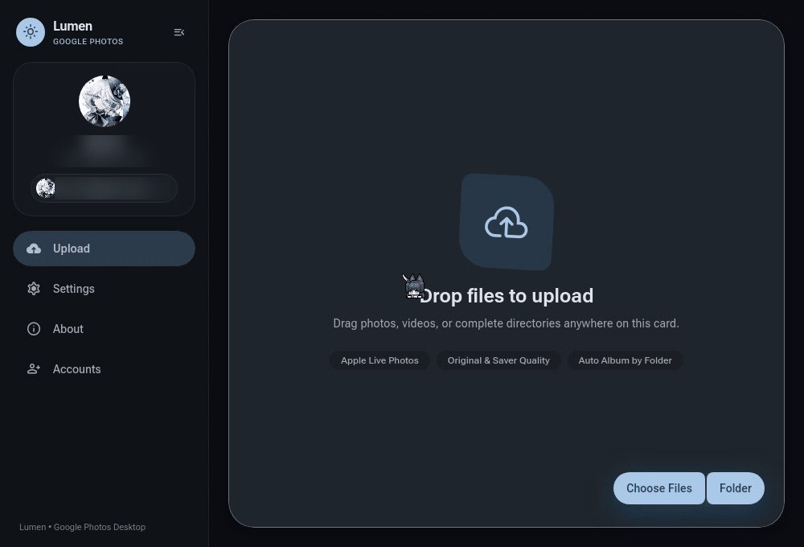

# Lumen

Lumen is an unofficial desktop client for Google Photos, built with Wails and Vue 3. It's a fork of [gotohp](https://github.com/xob0t/gotohp) with a redesigned Material 3 Expressive interface. Core upload and authentication logic are inherited from upstream.



> **Disclaimer:** Unofficial client. Not affiliated with, endorsed by, or supported by Google LLC. Google Photos is a trademark of Google LLC.

> *Looking for the Android mobile app? Check out **[Lumen for Android](https://github.com/Reiux/lumen-android)**.*

---

## Features

- **Free storage backup:** Upload photos and videos without counting against your Google storage quota (you can also turn quota usage back on).
- **Smooth sliding navigation:** The interface slides smoothly between Upload, Settings, and About views.
- **Collapsible sidebar:** Automatically adapts between an expanded sidebar on larger screens and a compact icon rail on smaller screens (or toggle it manually).
- **Drag and drop:** Drop files or folders directly into the window, or use the file picker button.
- **Apple Live Photos:** Automatically pairs `.heic` and `.jpg` photos with their matching `.mov` video clips.
- **Duplicate skipping:** Caches hashes of uploaded files locally so you don't re-upload photos you've already backed up.
- **Bandwidth limiter:** Limit upload speeds from 0.5 MB/s up to 50 MB/s, or leave it unlimited.
- **Folder watcher:** Monitor folders in the background to automatically upload new photos as they are added.
- **System tray:** Runs in the background when minimized and shows a notification when batch uploads finish.
- **Multiple accounts:** Add and switch between multiple Google accounts.
- **Album support:** Upload directly to existing albums or automatically create albums named after your folders.
- **Standalone CLI:** Includes a headless `lumen-cli` binary for running uploads in scripts, servers, or cron jobs.

---

## Downloads

Download prebuilt binaries for Linux, macOS, and Windows from the [Releases](https://github.com/Reiux/Lumen/releases/latest) page.

---

## CLI Usage

The standalone binary `lumen-cli` runs without any GUI dependencies. The desktop binary `lumen` also accepts these commands directly.

```shell
# Upload photos recursively using 5 threads
lumen-cli upload /path/to/photos --recursive --threads 5

# Upload directly to an album (creates it if it doesn't exist)
lumen-cli upload /path/to/trip --album "Tokyo 2026"

# Pair Apple Live Photos
lumen-cli upload /path/to/camera --pair-live-photos

# Use Storage Saver quality instead of original quality
lumen-cli upload /path/to/photos --saver

# Add credentials
lumen-cli creds add "<oauth_token cookie value>"
lumen-cli creds add "androidId=..."
lumen-cli creds add - < token.txt

# List and switch active account
lumen-cli creds list
lumen-cli creds set user@gmail.com
```

The CLI shares stored credentials with the GUI through the config file. Upload options (threads, quality, album, etc.) are controlled by command-line flags so scripts run predictably.

Run `lumen-cli --help` or `lumen-cli upload --help` for the full list of options.

---

## Sign In

### Option 1: Web sign-in (easiest)

1. Open Lumen and click **Connect Account** (or **Add Google account**).
2. Click **Open Google sign-in** to open the login page in your default browser.
3. Sign in to your account and click **I agree** on the Google Embedded Setup page. (If the page keeps loading afterward, that's normal).
4. Open your browser Developer Tools (`F12` or right-click -> Inspect).
5. Go to **Application** (or **Storage**) -> **Cookies** -> `https://accounts.google.com`.
6. Copy the value of the `oauth_token` cookie.
7. Paste it into Lumen and click **Connect account**.

From the CLI:
```shell
lumen-cli creds add "<oauth_token value>"
```

### Option 2: ReVanced (No root required)

<details>
  <summary><strong>View instructions</strong></summary>

1. Install Google Photos ReVanced on your Android device or emulator:
   - Install [GmsCore](https://github.com/ReVanced/GmsCore/releases).
   - Install a patched Google Photos APK (via [Morphe-AutoBuilds](https://github.com/RookieEnough/Morphe-AutoBuilds/releases) or patch it yourself using ReVanced Manager).
2. Enable USB debugging and connect your device to your PC via ADB.
3. Open a terminal on your PC and run:

   **Linux / macOS:**
   ```shell
   adb logcat | grep "auth%2Fphotos.native"
   ```

   **Windows (Command Prompt):**
   ```cmd
   adb logcat | FINDSTR "auth%2Fphotos.native"
   ```

4. If you already had an account logged in, remove the Google account from GmsCore first.
5. Open Google Photos ReVanced on the device and sign in.
6. A log line containing the authentication parameters will appear in your terminal.
7. Copy the string starting from `androidId=` through to the end of that line.
8. Paste that string into Lumen or run `lumen-cli creds add "androidId=..."`.

</details>

### Option 3: Official APK (Root required)

<details>
  <summary><strong>View instructions</strong></summary>

1. Make sure you have a rooted Android device or emulator with ADB root access.
2. Connect your device via ADB and install [HTTP Toolkit](https://httptoolkit.com).
3. In HTTP Toolkit, choose **Android Device via ADB** intercept mode.
4. Filter intercepted traffic using:
   ```text
   contains(https://www.googleapis.com/auth/photos.native)
   ```
   *(For older Google Photos versions, try `contains(www.googleapis.com%2Fauth%2Fplus.photos.readwrite)`).*
5. Open the official Google Photos app on your device and log in.
6. When the matching request appears in HTTP Toolkit, copy the request body text.
7. Paste the body string into Lumen.
8. If Lumen asks for a token binding key, keep the device connected with ADB root enabled and click **Read from ADB**. Lumen will read `lstBindingKeyAlias` from the Android AccountManager and attach it to the credential.

#### Troubleshooting
- **No request intercepted:** Log out and log back in, or use HTTP Toolkit's `Android App via Frida` interception method.
- **Token binding key not found:** Confirm root is granted to ADB shell (`adb root`) and the target Google account is present on the device.

</details>

---

## Building from Source

### Prerequisites

- **Go:** 1.24 or higher
- **Node.js:** 20.x or higher with `npm`
- **C Compiler:** `gcc` or `clang`
- **Linux packages (Linux only):** `gtk3`, `webkit2gtk-4.1` (or `webkit2gtk-4.0`), `pkg-config`
  - Arch / CachyOS: `sudo pacman -S webkit2gtk-4.1 gtk3 base-devel`
  - Debian / Ubuntu: `sudo apt-get install libgtk-3-dev libwebkit2gtk-4.1-dev build-essential`
  - Fedora: `sudo dnf install gtk3-devel webkit2gtk4.1-devel gcc`
- **Wails v3 CLI (optional):**
  ```shell
  go install github.com/wailsapp/wails/v3/cmd/wails3@latest
  ```

### Build Steps

1. **Clone the repository:**
   ```shell
   git clone https://github.com/Reiux/Lumen.git
   cd Lumen
   ```

2. **Build frontend assets:**
   ```shell
   cd frontend
   npm install
   npm run build
   cd ..
   ```

3. **Build the desktop GUI:**
   ```shell
   go build -o bin/lumen .
   ```

4. **Build the standalone CLI:**
   ```shell
   go build -tags cli -o bin/lumen-cli .
   ```

Alternatively, if you use [Task](https://taskfile.dev):
```shell
task build
```

---

## Configuration

Lumen stores configuration and saved accounts in:
- **Linux:** `~/.config/gotohp/gotohp.config`
- **macOS:** `~/Library/Application Support/gotohp/gotohp.config`
- **Windows:** `%APPDATA%\gotohp\gotohp.config`

To run portably, place an empty `gotohp.config` file next to the binary.

---

## Credits & License

- Original project and upload logic: [gotohp](https://github.com/xob0t/gotohp) by [xob0t](https://github.com/xob0t).
- UI redesign & enhancements: [Reiux](https://github.com/Reiux).
- Licensed under the [MIT License](LICENSE).
